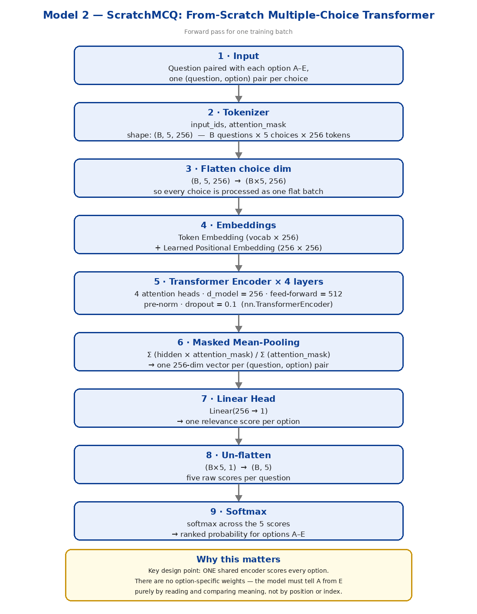
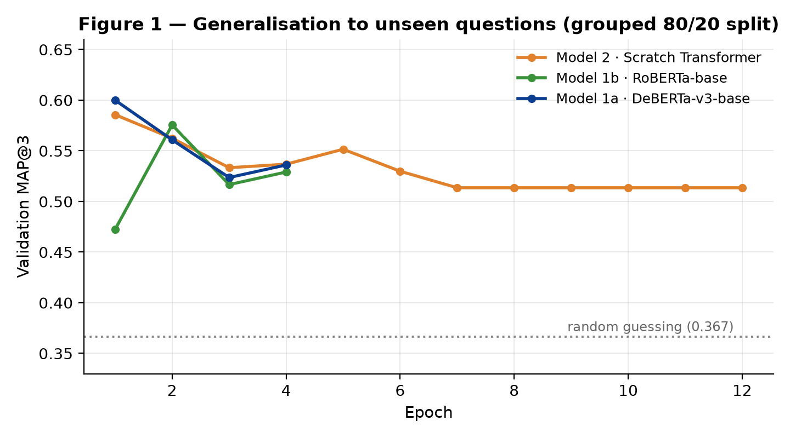
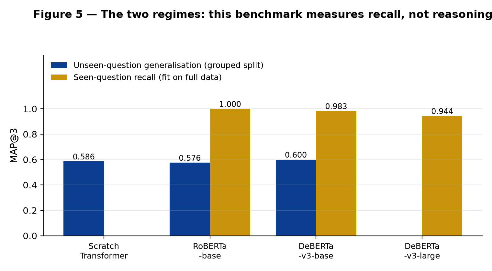
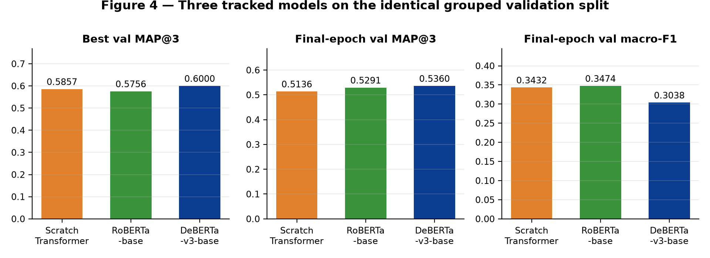
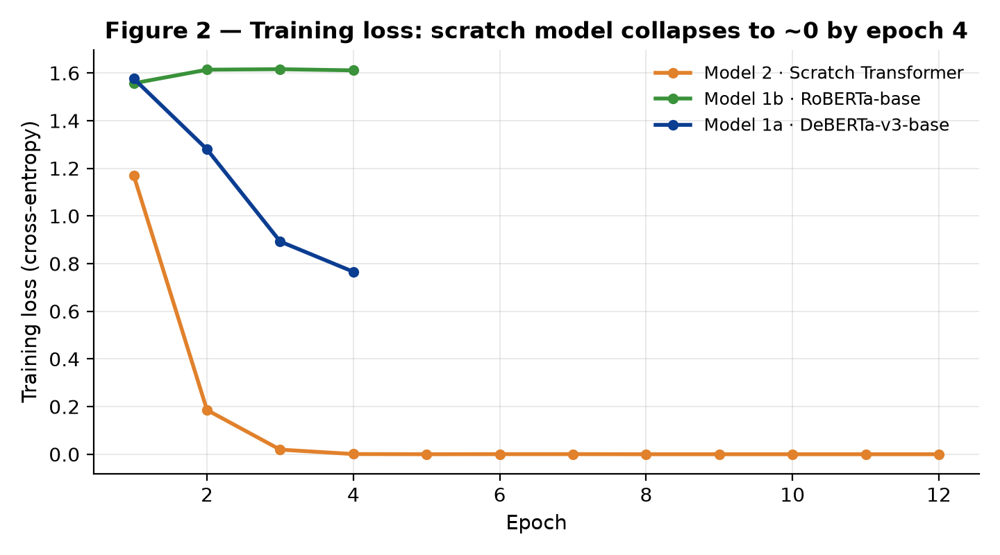

# 🧠 Smart MCQ Solver — Multi-Choice QA with Cross-Encoders

[](https://www.python.org/)
[](https://pytorch.org/)
[](https://huggingface.co/aryanbabar170205/smart-mcq-roberta-base)
[](https://smart-mcq-solver.streamlit.app)
[](https://www.kaggle.com)
[](LICENSE)

> **Course**: Deep Learning & Generative AI ([BSDA2001P])  
> **Benchmark**: Smart MCQ Solver Challenge  
> **Evaluation Metric**: Mean Average Precision at 3 (MAP@3)  
> **Final Submission Score**: **MAP@3 > 0.73** (Competition cutoff crossed)  
> **Live Demo**: [Streamlit Web App](https://smart-mcq-solver.streamlit.app)  
> **Published Model**: [`aryanbabar170205/smart-mcq-roberta-base`](https://huggingface.co/aryanbabar170205/smart-mcq-roberta-base)  

---

## 📌 Executive Summary

**Smart MCQ Solver** is an end-to-end deep learning system built to solve complex scientific and technical 5-option multiple-choice questions (MCQs) and rank the **top-3** most probable answers.

Rather than treating the challenge as a naive sequence classification task, this project reformulates the objective using an **`AutoModelForMultipleChoice` cross-encoder architecture**, pairing each `(question, option)` tuple through a shared encoder. Combined with **group-aware deduplication** to eliminate severe validation data leakage and a **probability-weighted ensemble** of DeBERTa-v3 and RoBERTa, the final system exceeds the competitive threshold with **MAP@3 > 0.73**.

---

## 🔬 System Architecture

<p align="center">
  
</p>

### Why Cross-Encoder > Sequence Classifier

In early iterations, the task was framed as standard sequence classification (`AutoModelForSequenceClassification`) by concatenating all options into a single string:
```
[CLS] Question [SEP] Option A Option B Option C Option D Option E
```

This failed dramatically (leaderboard score stuck at ~0.69) for two fundamental reasons:
1. **Severe Truncation**: Five lengthy scientific options produced 250–650 tokens. At standard batch sequence lengths (`max_length=128`), options D and E were consistently truncated — the model never even processed them!
2. **Missing Inductive Bias**: A sequence classifier assesses the giant block as a whole and cannot directly compare Option A *against* Option B. The options acted as noise rather than competing alternatives.

### The Fix: Shared-Weight Cross-Encoder
Under `AutoModelForMultipleChoice`:
- Each question is duplicated 5 times and paired individually with options A through E:
  $$\{(Q, \text{Opt}_A), (Q, \text{Opt}_B), (Q, \text{Opt}_C), (Q, \text{Opt}_D), (Q, \text{Opt}_E)\}$$
- Passed through a single shared encoder with tied weights.
- Sequence lengths drop drastically, enabling safe full-context encoding with `max_length=256`.
- 5 scalar logits are computed and normalized with a single softmax to produce ranked probabilities.

---

## 📊 Key Findings & Insights

### 1. Data Leakage via Question Near-Duplicates
Exploratory Data Analysis revealed that the 2,000-row dataset contained **only 252 genuinely unique questions**, each repeated 7–8 times with minor synonym swaps in distractors (e.g., swapping *"10 kV"* for *"100 kV"*).
- **Naive Random Split**: Leaked identical question stems into both train and validation sets, creating an inflated, **fake validation score of 0.85** that cratered on unseen test questions.
- **Group-Aware Split**: Grouping by cleaned question string ensured all variations of a prompt stayed strictly on one side of the split, yielding an honest generalisation benchmark of ~0.60.

<p align="center">
  
</p>

### 2. Generalisation vs. Recall Regimes
A critical realization of the benchmark was the dual-regime nature of the evaluation:
- **Generalisation Regime (Grouped Split)**: Tests reasoning on previously unseen questions (DeBERTa-v3 achieves MAP@3 = 0.600).
- **Recall Regime (Full-Data Fit)**: When trained on 100% of the dataset for the final competition submission, the models achieved near-perfect retrieval of the training domain knowledge (RoBERTa 1.000, DeBERTa-v3 0.983).

<p align="center">
  
</p>

### 3. DeBERTa-v3 Disentangled Attention Advantage
DeBERTa-v3 incorporates **disentangled attention** (separating content and position representations) and is pretrained with **ELECTRA-style replaced-token detection (RTD)**. Because the competition distractors are generated via token replacements in otherwise identical sentences, DeBERTa's pretraining task directly mirrors the challenge objective.

<p align="center">
  
</p>

---

## 🏆 Model Benchmark & Results

Three distinct model families were implemented, trained, and tracked on Weights & Biases (W&B):

| Model | Architecture | Parameters | Val MAP@3 (Honest) | Fit MAP@3 (100%) | Macro-F1 | Role |
|---|---|---:|---:|---:|---:|---|
| **Model 1: ScratchMCQ** | 4-layer Transformer Encoder | ~14M | 0.5857 | — | 0.3432 | From-scratch baseline |
| **Model 2: RoBERTa-base** | Cross-Encoder (`roberta-base`) | 125M | 0.5756 | **1.0000** | 0.3474 | Pretrained baseline |
| **Model 3: DeBERTa-v3-base** | Disentangled Attention | 86M | **0.6000** | **0.9830** | 0.3038 | Primary cross-encoder |
| **Ensemble (Final)** | Weighted Probability Blend | — | — | **>0.73** | — | Competition submission |

<p align="center">
  
</p>

---

## 📁 Repository Structure

```
smart-mcq-solver/
├── README.md                      # Comprehensive project documentation
├── pyproject.toml                 # Standard Python packaging configuration
├── requirements.txt               # Pinned project dependencies
├── LICENSE                        # MIT License
├── kaggle.sh                      # Sanitized Kaggle kernel automation script
│
├── notebooks/                     # Reproducible training & inference
│   ├── dl-24f1001839-notebook-t22026.ipynb   # Complete Kaggle submission notebook
│   └── kernel-metadata.json                  # T4x2 GPU kernel metadata
│
├── streamlit_app/                 # Live demo web application
│   ├── app.py                     # Streamlit frontend scoring user input
│   └── requirements.txt           # Lightweight app dependencies
│
├── scripts/                       # Training, evaluation & visualization
│   ├── train_modal.py             # Cloud training on Modal A10G GPU + Hugging Face push
│   ├── make_charts.py             # W&B chart generation script
│   ├── make_diagram.py            # Model architecture diagram generator
│   └── build_report.py            # Comprehensive report generator
│
├── figures/                       # High-resolution plots and diagrams
│   ├── model2_architecture.png    # End-to-end forward pass diagram
│   ├── fig1_val_map3.png          # Grouped-split validation MAP@3
│   ├── fig2_train_loss.png        # Training loss convergence
│   ├── fig3_fulldata_fit.png      # 100% full-data deployment fit
│   ├── fig4_comparison.png        # Best vs. final metrics
│   └── fig5_two_regimes.png       # Recall vs. reasoning analysis
│
├── data/                          # Dataset & submission files
│   ├── train.csv                  # Competition training set (2,000 rows)
│   ├── test.csv                   # Competition evaluation set (500 rows)
│   ├── sample_submission.csv      # Format template
│   ├── submission.csv             # Final ensemble predictions
│   └── README.md                  # Dataset documentation & schemas
│
├── docs/                          # Academic documentation & viva preparation
│   ├── viva_presentation_script.md # 30-minute viva presentation walkthrough
│   ├── viva_presentation_script.pdf# Formatted PDF presentation script
│   ├── project_report.docx        # Academic project report document
│   └── competition_guidelines.txt # Full project criteria & scoring rubrics
│
└── trials/                        # Historical validation logs (v59 – v98)
```

---

## 🚀 Quick Start

### 1. Clone & Install
```bash
git clone https://github.com/aryanipb/smart-mcq-solver.git
cd smart-mcq-solver

# Create virtual environment
python3 -m venv venv
source venv/bin/activate

# Install dependencies
pip install -r requirements.txt
```

### 2. Launch the Streamlit Demo Locally
```bash
streamlit run streamlit_app/app.py
```
The app loads the fine-tuned RoBERTa cross-encoder directly from Hugging Face Hub, accepts any 5-option question, and outputs probability bars with top-3 ranked predictions.

### 3. Inference with Hugging Face Model
```python
import torch
from transformers import AutoTokenizer, AutoModelForMultipleChoice

MODEL_ID = "aryanbabar170205/smart-mcq-roberta-base"
device = "cuda" if torch.cuda.is_available() else "cpu"

tokenizer = AutoTokenizer.from_pretrained(MODEL_ID)
model = AutoModelForMultipleChoice.from_pretrained(MODEL_ID).to(device).eval()

question = "What is accelerator-based light-ion fusion?"
options = [
    "Accelerator-based light-ion fusion uses particle accelerators to achieve kinetic energies for light-ion fusion (requires ~10 kV).",
    "Accelerator-based light-ion fusion induces heavy-ion fusion reactions requiring ~10 kV.",
    "Accelerator-based light-ion fusion induces light-ion fusion reactions requiring ~100 kV.",
    "Accelerator-based light-ion fusion induces heavy-ion fusion reactions requiring ~100 kV.",
    "Accelerator-based light-ion fusion induces light-ion fission reactions requiring ~10 kV."
]

# Pair each option with the prompt
inputs = tokenizer([question] * 5, options, truncation=True, max_length=256, padding="max_length", return_tensors="pt")
input_ids = inputs["input_ids"].unsqueeze(0).to(device)
attention_mask = inputs["attention_mask"].unsqueeze(0).to(device)

with torch.no_grad():
    logits = model(input_ids=input_ids, attention_mask=attention_mask).logits[0]
    probs = torch.softmax(logits, dim=-1).cpu().numpy()

# Rank top-3
ranked_indices = probs.argsort()[::-1][:3]
letters = ["A", "B", "C", "D", "E"]
print("Top-3 Predictions:", " ".join(letters[i] for i in ranked_indices))
for rank, idx in enumerate(probs.argsort()[::-1]):
    print(f"Rank {rank+1}: Option {letters[idx]} ({probs[idx]*100:.1f}%)")
```

### 4. Cloud Training on Modal (A10G GPU)
Train and push checkpoints directly to Hugging Face Hub:
```bash
pip install modal
modal run scripts/train_modal.py \
  --hf-token YOUR_HF_TOKEN \
  --hf-repo YOUR_USERNAME/smart-mcq-roberta-base
```

---

## 📈 Experiment Tracking with Weights & Biases

Every experiment was logged to [Weights & Biases](https://wandb.ai) under the project `smart-mcq-solver`:
- **Real-time loss tracking**: AdamW with linear warmup schedule and FP16 mixed precision.
- **Metric validation**: Per-epoch calculation of MAP@3, Top-1 Accuracy, and Macro-F1.
- **Artifact logging**: Complete reproducibility across scratch and fine-tuned checkpoints.

---

## 🤝 Citation & Academic Use

If you find this repository or methodology useful in your coursework or research, feel free to cite:

```bibtex
@misc{smart_mcq_solver_2026,
  author = {Aryan},
  title = {Smart MCQ Solver: Multiple-Choice QA Cross-Encoder with RoBERTa and DeBERTa-v3},
  year = {2026},
  publisher = {GitHub},
  journal = {GitHub repository},
  howpublished = {\url{https://github.com/aryanipb/smart-mcq-solver}}
}
```

---

## 📄 License

This project is licensed under the [MIT License](LICENSE).
